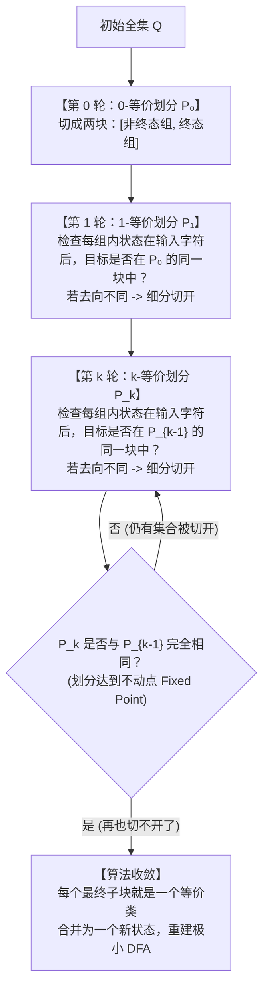
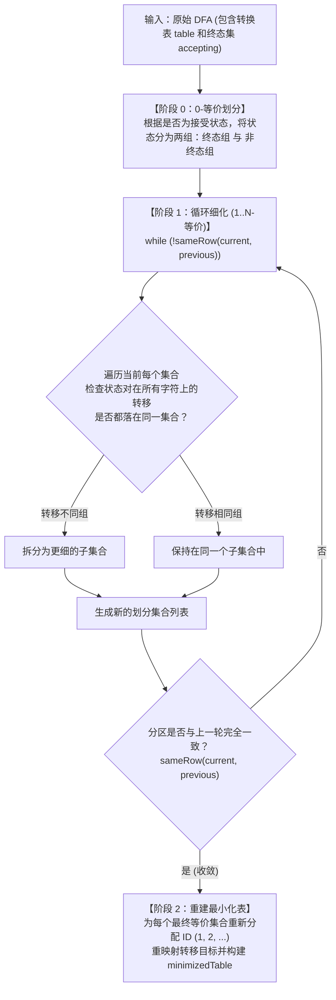

DFA 最小化（DFA Minimization）是形式语言与自动机理论中极其优美的一部分。

如果说 **子集构造** 解决了 **“从不确定到确定”**，那么 **DFA 最小化** 解决的就是 **“从冗余到精简”**。

下面为你系统梳理 DFA 最小化的全套理论知识体系。

---

### 一、核心理论基石：为什么一定能最小化？

#### 1. Myhill-Nerode 定理（极小 DFA 唯一性定理）
> **定理**：对于任意一个正则语言 $L$，存在且**仅存在一个**状态数最少的 DFA（在状态重命名的同构意义下唯一）。

这意味着：无论你的 NFA 有多乱，转换出来的原始 DFA 有多么庞大，只要经过最小化，它们最终都会**殊途同归**，缩减成那个**结构完全相同的、最完美的极小自动机**。

#### 2. 不可区分性（Indistinguishability）与状态等价
怎么知道两个状态 $p$ 和 $q$ 能不能合并？
理论上采用 **“黑盒测试实验”**：

假设你站在状态 $p$，另一个人站在状态 $q$。我们给你们两个人输入同一个任意字符串 $w$：
- 如果你走完 $w$ 到达了**接受状态**，而他走完 $w$ 到达了**拒绝状态**，那么字符串 $w$ 就把你们两个人区分开来了，称 $w$ 为 **区分串（Distinguishing String）**。
- 如果**没有任何字符串 $w \in \Sigma^*$** 能够把你们区分开来——也就是说，无论喂什么后续字符串，你们要么**同时接受**，要么**同时拒绝**，那么状态 $p$ 和 $q$ 就是 **等价的（Equivalent）**，记作：
$$p \sim q$$

**等价状态的核心结论**：
> 如果两个状态是等价的，外界任何输入都无法探测出它们俩的区别。因此，把它们合并为一个状态，**绝不会改变自动机对任何语言的识别结果**。

---

### 二、从无限到有限：$k$-等价性（$k$-Equivalence）理论

我们不可能用无穷多个字符串去逐一测试状态等价性。理论上是如何将其转化为**有限步计算**的？

答案是：**按测试字符串的长度 $k$ 进行分层归纳（$k$-等价）**。

| 等价层级                | 数学定义                                             | 直观含义                                    | 分组判据                                      |
| :---------------------- | :--------------------------------------------------- | :------------------------------------------ | :-------------------------------------------- |
| **$0$-等价 ($\sim_0$)** | 无法被长度为 **0** 的字符串（即空串 $\epsilon$）区分 | 还没输入任何字符就露出破绽                  | **同为接受状态，或同为非接受状态**            |
| **$1$-等价 ($\sim_1$)** | 无法被任何长度 **$\le 1$** 的字符串区分              | 消耗任意单个字符后，行为依然一致            | 在任何单字符转移后，落入同一个 $0$-等价组     |
| **$k$-等价 ($\sim_k$)** | 无法被任何长度 **$\le k$** 的字符串区分              | 消耗任意 $\le k$ 长度的字符串，行为依然一致 | 在任何单字符转移后，落入同一个 $(k-1)$-等价组 |

#### $k$-等价的递推核心公式：
状态 $p$ 与 $q$ 是 $k$-等价的，当且仅当：
1. $p$ 和 $q$ 本身是 $(k-1)$-等价的；
2. 对于字母表中的任意输入字符 $a \in \Sigma$：
$$\delta(p, a) \sim_{k-1} \delta(q, a)$$

> **通俗理解**：如果我知道你们在测试长度为 $k-1$ 的字符串时是分不出区别的，那么要测长度为 $k$ 的串，只需要让你们每人先走一步（吃进一个字符 $a$），看你们**走到的新状态是不是属于同一伙人（$(k-1)$-等价组）**。如果是，那在长度 $k$ 上你们依然无法被区分！

---

### 三、算法推演机制：分区细化（Partition Refinement）

这个算法在学术上通常被称为 **Moore 状态最小化算法**（也是 `dfa-minimizer.js` 源码所实现的机制）。

它的运作方式是：**从最粗的粗粒度划分开始，不断用转移去向把集合“切碎”，直到切不动为止**。



#### 算法必定终止的数学证明（收敛性）：
1. **单调性**：集合只能被**拆分（Refine）**，绝不可能发生两个集合重新合并的情况。
2. **有限性**：总状态数 $|Q| = n$ 是有限的。一个拥有 $n$ 个元素的集合，最多只能被切成 $n$ 个单元素子集。
3. **步数上界**：每一轮至少要切出一刀，如果不发生拆分就会立即终止。因此算法最多在 **$n - 1$** 轮内必定收敛停机！

---

### 四、最终重构：商自动机（Quotient Automaton）

当分区细化终止后，我们得到了一组最终的互不相交的等价类子集：
$$\mathcal{P} = \{ [q_1], [q_2], \dots, [q_m] \}$$

如何用这组集合构建最小化 DFA？
形式语言理论中称此为构建 **商自动机（Quotient Automaton） $M / \sim$**：

1. **新状态集 $Q'$**：每个等价类作为一个新状态（例如类 $\{2, 3, 4\}$ 变成单个新状态 `2`）。
2. **新起始状态 $q_0'$**：包含原起始状态 $q_0$ 的那个等价类 $[q_0]$。
3. **新终态集 $F'$**：所有由原终态组成的等价类。
4. **新转移函数 $\delta'$**：
$$\delta'([q], a) = [\delta(q, a)]$$
   - **理论良定义（Well-defined）保证**：从等价类 $[q]$ 中**随便挑出哪一个代表状态**，计算其在字符 $a$ 下的转移，其结果落入的等价类都**绝对是同一个**！这是等价类数学性质严格保证的。

---

### 五、经典算法对比：三大最小化流派

在编译原理与计算理论中，DFA 最小化主要有三种经典算法：

| 算法名称                                                  | 核心思路                                                                      | 时间复杂度 | 特点   |
| :-------------------------------------------------------- | :---------------------------------------------------------------------------- | :--------: | :----- |
| **Moore 算法**<br>*(即我们的代码实现)*                    | **自顶向下细化**<br>从 $\{F, Q \setminus F\}$ 开始逐步切分集合                |    $O(     | \Sigma | \cdot | Q | ^2)$ | 直观易懂，代码实现简单，适合教学与常规正则引擎                     |
| **Hopcroft 算法**<br>*(工业界首选)*                       | **反向划分优化**<br>“只用较小的子集去分割其他集合”（利用了 $\log$ 技巧）      |    $O(     | \Sigma | \cdot | Q | \log | Q                                                                  | )$ | 理论最快，是 GNU `grep`、现代编译器（如 LLVM、Lex/Flex）的最爱 |
| **填表法 (Table-Filling)**<br>*(又称 Myhill-Nerode 算法)* | **自底向上标记**<br>维护一个下三角矩阵，逐对寻找“可区分状态对 $(p, q)$”并打勾 |    $O(     | \Sigma | \cdot | Q | ^2)$ | 极适合人类**在纸上手算推导**和考研做题，直观展示状态间的一对一区别 |

---

### 总结六字诀

理解 DFA 最小化，只需记住六个字：
- **区分（Distinguish）**：只要有任意后续输入能让一个接受、一个拒绝，就必须分开；
- **细化（Refine）**：按转移目标一步步细分，能分则分；
- **合并（Merge）**：既然无论怎么输入都完全分不开，就彻底打包成一个状态。
在 [`dfa-minimizer.js`](file:///home/supreme/Workspace/fundamentals-of-compiling/Automata%20Theory%20inside%20a%20RegExp%20machine/regexp-tree/src/interpreter/finite-automaton/dfa/dfa-minimizer.js) 中，DFA 最小化采用的是经典编译原理中的 **$k$-等价性状态划分算法（$k$-Equivalence Partition Refinement / Moore 算法）**。

其核心思路是：**寻找行为完全等价的状态并将它们合并为一个超级状态**。如果两个状态在面对任意后续字符输入时，走向的接受/拒绝结论完全一致，那么它们就是等价的，保留多个只是冗余。

---

### 一、整体算法架构概览

整个算法流程可以划分为三大核心步骤：



---

### 二、核心数据结构

在阅读代码前，先理解这几个核心变量的作用：

1. **`currentTransitionMap`**（全局/闭包映射字典）：
   - 结构：`{ [stateNumber]: Set }`
   - **作用**：记录每个原始状态当前**属于哪一个集合（划分块）**。
   - 例如状态 2 和状态 3 同在终态组 `S_accept`，则 `currentTransitionMap[2] === S_accept`，`currentTransitionMap[3] === S_accept`。
2. **`all`**（历史划分栈）：
   - `all[0]`：0-等价的分组结果 `[nonAccepting, accepting]`
   - `all[1]`：1-等价的分组结果
   - `all[N]`：最终稳定的分组结果
3. **`remaped`**（`Map<Set, number>`）：
   - 将最终合并后的每一个 `Set`（等价集合），重新赋予一个精简的状态编号（如 1, 2, ...）。

---

### 三、源码逐段详细解析

#### 1. 阶段 0：构建 0-等价初始划分（行 20 ~ 51）

```javascript
// 行 20-40: 初始化分类
function minimize(dfa) {
  const table = dfa.getTransitionTable();
  const allStates = Object.keys(table);
  const alphabet = dfa.getAlphabet();
  const accepting = dfa.getAcceptingStateNumbers();

  currentTransitionMap = {};
  const nonAccepting = new Set();

  allStates.forEach(state => {
    state = Number(state);
    const isAccepting = accepting.has(state);

    if (isAccepting) {
      currentTransitionMap[state] = accepting;
    } else {
      nonAccepting.add(state);
      currentTransitionMap[state] = nonAccepting;
    }
  });

  // 行 46-50: 0-等价集合放入 all 数组
  const all = [
    [nonAccepting, accepting].filter(set => set.size > 0),
  ];
```
- **原理解析**：
  - **0-等价** 代表消耗空串 $\epsilon$ 后的行为：终态直接接受，非终态不接受。
  - 所以最粗粒度的分类就是将状态划分为 **非终态组 `nonAccepting`** 与 **终态组 `accepting`**。
  - `currentTransitionMap` 建立了 `状态 ID -> 所在 Set` 的引用映射。

---

#### 2. 阶段 1：循环细化（1..N-等价）（行 53 ~ 109）

```javascript
  let current = all[all.length - 1];
  let previous = all[all.length - 2];

  // 直到本轮与上一轮分区完全一致（即不再发生拆分）
  while (!sameRow(current, previous)) {
    const newTransitionMap = {};

    // 遍历当前这一轮中的每一个集合（例如当前的非终态集合）
    for (const set of current) {
      const handledStates = {};

      // 取出第一个状态作为当前子组的基准
      const [first, ...rest] = set;
      handledStates[first] = new Set([first]);

      // 遍历集合中剩余的其他状态，尝试看它们是否与已处理的状态等价
      restSets: for (const state of rest) {
        for (const handledState of Object.keys(handledStates)) {
          // 如果当前状态与某个已处理状态等价：加入该状态所在的 Set
          if (areEquivalent(state, handledState, table, alphabet)) {
            handledStates[handledState].add(state);
            handledStates[state] = handledStates[handledState];
            continue restSets;
          }
        }
        // 如果与现有子组都不等价，为它独立新建一个集合
        handledStates[state] = new Set([state]);
      }

      // 将该集合细化后的状态映射合并到 newTransitionMap 中
      Object.assign(newTransitionMap, handledStates);
    }

    currentTransitionMap = newTransitionMap;

    // 利用 Set 对相同引用的 Set 实例去重，得到本轮所有的独立分区
    let newSets = new Set(
      Object.keys(newTransitionMap).map(state => newTransitionMap[state])
    );

    all.push([...newSets]);
    current = all[all.length - 1];
    previous = all[all.length - 2];
  }
```

- **细化过程机制**：
  1. 对当前集合 `set = [A, B, C]`：
  2. 先把 `A` 放入新组：`Group1 = {A}`。
  3. 检查 `B`：调用 `areEquivalent(B, A, ...)`。
     - 如果等价，`Group1.add(B)`，变成 `{A, B}`；
     - 如果不等价，为 `B` 创建新组 `Group2 = {B}`。
  4. 检查 `C`：分别与已有的代表状态对比，决定并入 `Group1`、`Group2` 还是新建 `Group3`。
  5. 每一轮结束时，如果分区不再变化（`sameRow(current, previous) === true`），说明已经达到不可再分的极小状态集，跳出循环。

---

#### 3. 核心判定函数：`areEquivalent` 与 `goToSameSet`（行 186 ~ 218）

两个状态在当前轮次下被判定为等价的前提是：**在字母表的所有字符上，它们的目标去向必须一致**。

```javascript
function areEquivalent(s1, s2, table, alphabet) {
  for (const symbol of alphabet) {
    if (!goToSameSet(s1, s2, table, symbol)) {
      return false; // 只要有一个字符去向不同，就不是等价状态
    }
  }
  return true;
}

function goToSameSet(s1, s2, table, symbol) {
  if (!currentTransitionMap[s1] || !currentTransitionMap[s2]) {
    return false;
  }

  const originalTransitionS1 = table[s1][symbol];
  const originalTransitionS2 = table[s2][symbol];

  // 情况 1：两者在该字符上都没有出边，视为行为一致
  if (!originalTransitionS1 && !originalTransitionS2) {
    return true;
  }

  // 情况 2：检查转移目标是否在有效集合中
  return currentTransitionMap[s1].has(originalTransitionS1) &&
    currentTransitionMap[s2].has(originalTransitionS2);
}
```

> [!NOTE]
> **代码实现细节探讨**：
> 在经典的 Moore 算法中，两个状态在字符 $c$ 上的转移 $\delta(s_1, c) = t_1$ 与 $\delta(s_2, c) = t_2$ 等价的充要条件是 **$t_1$ 和 $t_2$ 落在同一个划分块中**，即 `currentTransitionMap[t1] === currentTransitionMap[t2]`。
> 
> 在本源码中：
> - 终态无出边时通过行 211 `!originalTransitionS1 && !originalTransitionS2` 判定为 `true`（例如 `/a|b|c/` 的多个接受状态）；
> - 自环或内部闭包转移通过 `currentTransitionMap[s1].has(originalTransitionS1)` 判断。

---

#### 4. 终止条件检查：`sameRow`（行 161 ~ 184）

```javascript
function sameRow(r1, r2) {
  if (!r2) return false;
  if (r1.length !== r2.length) return false;

  for (let i = 0; i < r1.length; i++) {
    const s1 = r1[i];
    const s2 = r2[i];

    if (s1.size !== s2.size) return false;
    // 将 Set 内部元素排序转为字符串进行比对，如 "2,3" === "2,3"
    if ([...s1].sort().join(',') !== [...s2].sort().join(',')) {
      return false;
    }
  }
  return true;
}
```
比较相邻两轮（如第 $k$ 轮与第 $k-1$ 轮）的分区数组。当两轮中集合个数相同、每个集合大小相同且包含的状态 ID 完全一致时，算法达到不动点（Fixed-point），终止细化。

---

#### 5. 阶段 2：重构最小化转换表（行 111 ~ 159）

此时每个等价状态集合 `Set` 就是最小化 DFA 的一个节点。代码在这里做**状态重编号与表重建**：

```javascript
  // 1. 给每个最终的等价集合分配新的状态编号 (1, 2, 3...)
  const remaped = new Map();
  let idx = 1;
  current.forEach(set => remaped.set(set, idx++));

  const minimizedTable = {};
  const minimizedAcceptingStates = new Set();

  // 辅助函数：如果集合内包含原接受状态，则新 ID 也为接受状态
  const updateAcceptingStates = (set, idx) => {
    for (const state of set) {
      if (accepting.has(state)) {
        minimizedAcceptingStates.add(idx);
      }
    }
  };

  // 2. 构建最小化转换表
  for (const [set, idx] of remaped.entries()) {
    minimizedTable[idx] = {};
    for (const symbol of alphabet) {
      updateAcceptingStates(set, idx);

      // 从原集合中任选一个代表状态，取出该字符的原始转移目标
      let originalTransition;
      for (const originalState of set) {
        originalTransition = table[originalState][symbol];
        if (originalTransition) {
          break;
        }
      }

      // 如果有转移，通过 currentTransitionMap 找到目标所在的集合，再映射到新的 idx
      if (originalTransition) {
        minimizedTable[idx][symbol] = remaped.get(
          currentTransitionMap[originalTransition]
        );
      }
    }
  }

  // 3. 写回 DFA 实例
  dfa.setTransitionTable(minimizedTable);
  dfa.setAcceptingStateNumbers(minimizedAcceptingStates);

  return dfa;
```

---

### 四、实战推演：以 `/a|b|c|d/` 的测试用例为例

来看 [`dfa-minimizer-test.js`](file:///home/supreme/Workspace/fundamentals-of-compiling/Automata%20Theory%20inside%20a%20RegExp%20machine/regexp-tree/src/interpreter/finite-automaton/dfa/__tests__/dfa-minimizer-test.js#L28-L44) 中的真实用例：

#### 1. 原始 DFA 表：
- 状态 `1`：非终态，`{ a: 5, b: 4, c: 3, d: 2 }`
- 状态 `2, 3, 4, 5`：全是接受状态，且没有出边 `{}`

#### 2. 执行过程追踪：

| 步骤               | 操作                                    | 结果                                                                                                                                                           |
| :----------------- | :-------------------------------------- | :------------------------------------------------------------------------------------------------------------------------------------------------------------- |
| **0-等价划分**     | 区分非终态与终态                        | `nonAccepting = {1}`<br>`accepting = {2, 3, 4, 5}`                                                                                                             |
| **1-等价细化**     | 1. 检查 `{1}`<br>2. 检查 `{2, 3, 4, 5}` | 1. 只有单状态，无需拆分。<br>2. 以 `2` 为基准；`3, 4, 5` 在所有字符上都无转移，`goToSameSet` 均返回 `true`，全部与 `2` 等价。保持为同一个集合 `{2, 3, 4, 5}`。 |
| **收敛判断**       | 比较 `all[1]` 与 `all[0]`               | 两个集合完全相同，`sameRow` 返回 `true`，循环结束！                                                                                                            |
| **重映射 (Remap)** | 分配新 ID                               | `{1}` $\to$ **新状态 1**<br>`{2, 3, 4, 5}` $\to$ **新状态 2**（接受状态）                                                                                      |
| **构建新表**       | 重建边转移                              | 状态 1 对 `a,b,c,d` 均转移到 `{2,3,4,5}`，即 **新状态 2**<br>状态 2 无出边 `{}`                                                                                |

#### 3. 最终最小化表：
```javascript
minimizedTable = {
  1: { a: 2, b: 2, c: 2, d: 2 },
  2: {}
}
minimizedAcceptingStates = Set { 2 }
```
原 DFA 从 **5 个状态**精简为 **2 个状态**，完全消除了冗余状态。