#### 股市里能赚的三种钱

- 央行的钱，通胀的钱
- 上市公司的钱
- 彼此掏兜的钱

#### KDJ案例

2007年6月4日,上证指数暴跌8.26%,当日KDJ的J值为-8.525,随后指数一路震荡上行来到6124点。

2008年10月27日,上证指数暴跌 6.32%,当日KDJ的J值为-3.056,随后指数一路震荡上行来到反弹高点3478点。

2015年8月20日,上证指数连续五天暴跌,对应KDJ的J值连续四天出现负值——8月21日的J值是-4.487,8月24日的J值是-16.853,8月25日的J值是-20.702,8月26日的J值是-16.030。随后指数一路出现反弹。

#### RSI指数案例

证全指2023年2月3日60分钟图11:30的这根K线,RSI 指标打到28.678,跌而不破25，现了上涨。

**当RSI指标尚未跌破25的时候,你可以按照高低临界反手操作一把。**

**而当其跌破25的时候,算是某种程度的跌崩,跌崩自然会带来情绪的宣泄,宣泄的过程往往需要四个时间周期——日线上的跌崩,对应四个交易日的情绪宣泄;周线上的跌崩,对应四周的情绪宣泄。**

上证50指数 2022年3月15日的这根日K线:

上证50指数 2022年3月15日的这根日K线:

上证指数 2018年2月9日的这根日K线:

上证指数 2013年6月24日的这根日K线:

日K线的共同特征便是RSI 指标打到10以下。如果说20以下是发出了抄底的信号,那么10以下便可“无脑低吸”。这个机会可能一年也未必有一回。往往出现这样的机会,都伴随着重大利空的发生。譬如2020年2月3日这一天,长达三年的疫情肆虐正式开启;2018年2月9日这一天,特朗普决定开始制裁中国,2013年6月24日这一天,央行测试流动性.

当RSI 进入到20以下此时介入很容易陷入到一段跌势最快的行情当中去。这里还可结合量能来进一步判断抄底的成功率。通常下跌缩量阴(类似上图2022年4月26日这根K线),可能会是最后一根阴线。如果次日出现看涨吞没信号,即右边K线比左边K线大,长阳线吞噬掉前一天的低点,那么大概率就是成了。

**10以下介入,如果买了就看3天，否则就不买。**

中证全指2022年4月26日走出下跌缩量阴的次日,看涨吞没形态,这一天板块监测涨幅榜前十大板块中所有涨停的股票,翻倍率都在70%左右。

#### RSI个股案例

个股则是20以下,80以上.

大盘崩溃后的情绪宣泄需要四个时间单位,而个股往往只需要两个时间单位,平均第二个单位是介入抄底最优时机.

火炬电子(603678)的这波下跌,在此之前该股最低点出现在2023年3月28日,当天RSI指标打到9.755,随后发生了一个反向运动。由此可知,9.755 是这一波的低位极限点。2023年6月上半月的这一波下跌,其低位极限点便可据此做参考,只要某一天 RSI 指标再度打到9附近,就形成了一个博弈点。

**反弹到哪里?有个经验公式是:低位极限点的RSI 数值+50**

#### 分时案例

其较为有用的价值在于“均价之上&均价之下”。如果想要买在日内一个相对的低点,通常价格应尽可能买在均价线附近。过低地偏离均价线,通常没好事,**股价被打太深往往代表着走势已坏,若打深之后再往上回,策略上应减仓**。而过高地偏离均价线,就会在次日形成套利空间。

中润资源(000506)2023年3月17日的分时图显示,该股平均成交价格是5.25元。当日收盘价是5.56元,盘中上车的人至尾盘就已获利5个点,这对于尾盘上车的投资者来说,相当于第二天要顶着5个点以上的溢价去操作,这就显得很被动。因为根据“处置效应”,很多时候次日盘中会出现回落,而回落的第一波往往是打到平均成本附近。

通过股价是否在均线之上来判断放量涨停后的一波回撤何时会出现转机。比如张江高科(600895) 2023年3月9日涨停,随后走了一个“上升三法”的图形。

后面三日的走势如下，区别在于,前两日股价均未在均价线之上,而回调第三天的分时走势已开始往回收敛,并且尾盘站上均价线。

苏州科达(603660) 2023年3月1日同样走了一个“旗杆旗面”的图形。该股3月1日涨停,3月2日走出一字板,3月3日开始高位回落,3月6日、7日、8日、9日连续整理,3月10日重迎来升势。

股价站上均价线出现在3月8日及3月9日,前者是阳线,后者是阴线,**阴线下的均线修复往往比阳线下的均线修复更能提供好的买点。**

买点可以这样判断,卖点也可以如是参考。当一只股票开始走连板模式,能否继续持有同样要观测分时图上尾盘股价有没有站稳均价线。这里对于“尾盘”的定义可以以两点半或者两点三刻为尺子。

漫步者(002351) 2023年3月17日开始涨停。其中,3月20日、22日、23日、24日、27日这五天,股价均在尾盘收于均价线之上,但3月21日这一天显得有点似是而非,如果当日选择卖出其实也合乎逻辑,但不走的话就能抓到之后一波短线上涨行情。很多时候指标偏偏落在临界点上,滑进滑出都可能带来假信号,这是在技术分析上我们需要容忍的地方。但到了3月28日这一天,股价明显在尾盘收于均价线之下,此时便要下定决心走。

宣泰医药(688247) 2022年12月上半月出现一波拉升,12月9日、12月12日这两天股价全在均价线上方,可继续持有。12月13日尾盘两点半股价落在均价线可上可下的地方,所以这一天卖也没问题,扛也没问题。12月14日信号依旧不明显,但12月15日股价算是明显处在均价线下方,因此最晚等到当日两点半之后,应决定离场。

人人乐(002336)从2022年12月6日至12月21日,股价全都在均价线之上,但到了12月22日这一天明显处在均价线之下。

#### 资金趋势判断离场

资金趋势指标显示有资金在往外流出，**用它来处理“涨停流出板”的问题**，次日高抛。 

若跟进首板个股,通常在之后会有套利空间,但前提条件是股价已便宜到不会再有人愿意在这个价格水平上抛售。

中通客车 2022年5月25日，红色线跑到绿色线之下就是要跑的信号。

#### 资金博弈/增仓排名判断

**庄家只会干掉那些既不敢又不能的弱者。**

漫步者 2023年3月10日是一个明显的进场点,当日资金博弈指标红色超大户线已向上穿越绿色散户线。除此之外,大户、中户、散户的数值均为负数,分别是:-0.653、-4.879、-2.246，增仓排名居第12位,是这一天当中唯一一只同时符合这两大技术指标特征的股票

#### 抄底

股价反弹的目标位是回到所有均线的上方,反之,股价下跌的目标位是回到所有均线的下方。

#### 积累优势因子

复盘如何复,简单说就是在过去的走势当中,找出某一天的优势因子,然后拿这个优势因子进行反复验证。

#### EXPMA

中百集团 2022年9月8日

股处在MACD 零轴上方,代表着股价已进入多头区域;再者 KDJ 指标由之前的死叉状态回到金叉状态,尤其KDJ的D值已经达到60。这里有一个窍门:D值不能太低也不能太高,落在60就挺香,这通常被看作是一个非常重要的追涨点。

XPMA 仅由两根均线形成,东方财富软件上的原始参数是(12,50),直接敲下这五个英文字母按回车键即可。其中,12这条蓝色线代表的是快线;50 这条粉色线代表的是慢线,约等于均线系统中的60日均线。

值得出手的时机是在快线和慢线形成金叉之后。假如两者是死叉,就不适合去做。这是对于EXPMA 指标运用的一个基本原则。

技术上,我们把多空平衡点设定在这根粉色线附近。在粉色线之上为多头区域,在粉色线之下为空头区域。无论追涨还是买跌,都要在多头区域进行。这样做的一个好处就是能够帮助投资者过滤掉大量杂波,节省了许多垃圾时间。

比如盘龙药业(002864)2022年7月15日 EXPMA 开始形成死叉

在金叉附近启动起来的涨停称之为“水面涨停”或“多空平衡点涨停”,不过当大盘处在跌势不止的背景下,水面涨停很难碰到,此时势必会有很多股票从底下翻上来,不能太教条。

如何确定它完全爬出了坑?只要未来其股价的高点突破它刚开始爬坑时的高点即可

对于这种高点的突破,距离 EXPMA这两条均线越近,危险性就越小。锦州港(600190) 2022年9月14日的这根K线也形成了高点突破,满足了包括EXPMA、KDJ、MACD 等这些指标的条件,但因为粉蓝两线离得太远,当天进去就很容易被套。

#### 股东人数

新华制药(000756) 2022年股东人数达到顶峰的时期是截止到6月30日的那一个季度,拉升即出货,出完货了股价就走熊样。像新华制药这一波走势尤显恶劣,前面横盘磨耐心,后面一字板不让“上车”,而不让“上车”的原因往往是为了把空间做足,待股价到达高位再不断带人进来。

兰州黄河(000929)在2021年6月30日之前走了一轮主升,随后开始套人,筹码进入收集阶段,从2021年的6月份一路收集到2022年的6月份,期间股东人数不断下降。
这个收集的动作大概率是利用下降段当中的每一次反拉阳线去做,而收集的平均成本可用市场均价来做参考,在2021年7月1日至2022年6月30日这个区间,最高价是11.72元,最低价是6.62元,均价则是9.21元。
当看到股价震荡无趋势且股东人数一年内都在稳步下降,那么这种图形就有启动的可能性,随后的每一波上冲都是热身,直至该股带量上攻来到了2022年9月28日这一天,股价打出13.28元的阶段新高,并爆出巨量,这一轮坐庄便告一段落。
主力花那么长时间收集筹码,若非其所为,何以来巨量?因此,当我们看到这一天股价天量见顶,就应该明白这是主力在往外扔筹码,跑得稍有迟疑,便会撞上次日低开跌停

稳妥反映在股东人数上通常呈一个缩减的态势。**最好股东人数的缩减幅度达到20%,这样筹码的收集程度才算比较好. **

**市净率最低的股票往往其收集程度是不够的。为什么越是低估的股票,其收集程度就越不够?是因为里面都是投资者,都是由于价格便宜所以长期买了不卖的价值投资者,这些筹码通常是洗不掉的。**

通证券(600837)截止到2023年8月初,市净率连一块钱都没到,市盈率才14倍,算是整个证券板块中明显低估的品种。

对应其股东人数尽管从2021年6月起大体呈递减趋势,但一直到2023年3月底,股东户数也无非是从31万户下降到了27万户,缩减幅度只不过10%多一点。虽然20% 不是一个必须达到的值,但至少要过15%,那么收集才算充分。

之所以筹码收集进程缓慢,主要在于这种类型的个股有足够的“安全垫”。假设我们以2023年8月初为阶段统计节点,可以看到自2021年7月至2023年8月,海通证券的平均建仓成本为10.71元,这个价格与2023年8月初的现价相差无几,只不过刚刚来到解套口,丝毫不存在主力出货的情况。

主力建仓建了那么长时间,股价涨30%也只能把成本挣出来,涨60%才能挣上钱。因此对于彼时的海通证券来说,股价至少往上加30%才是它将来的目标价,涨60%也正常,翻倍也正常。正因为往上的空间很大,而往下的空间几乎没有,所以才使得投资者不会轻易交出筹码。

问题也就出在股价太便宜上,什么东西能够快涨?就是在这里面抄底的人挣得是追涨的人的钱。换句话说,追涨的人进来要把抄底的人的获利全部接走,接完了之后,当股价形成震荡,待在里面抄底的人要么坚定不走,要么愿意走的也都会在这个震荡过程中下车。只有把这种处置效应吃掉,让市场成本不断抬高,主力才放心。

便宜的好东西大家都死捂着不放,筹码不交换,股价还怎么涨?

**决策打分表。很多时候我们打完分,方才能得个大概。比如我们把所有可比数据全都列出来,包括筹码收集程度、股价成本表现、目前股价阶段等等,当这些框架全都建立起来之后,投资组合也就随之出来了。随后取各个因子排名靠前的标的,形成一个股票池,从这池子里面去挑选要好过没有计划、没有方法地盲猜**

#### 线上持股，线下持币

线指的是30日均线。

2014年8月至2016年1月中证全指日K线实时走势图，实际下车的次数只有三次,而这三次下车所损失的差价对于整个一轮牛市的涨幅来说根本不值一提。当股价重回30日均线之上,则再追,这样能保证自己又回到这趟车上。

算2015年5月28日指数大跌6.14%,牛市是否在这一天结束不得而知,但由于其未跌破30日均线,因而可以再等等,直到2015年6月19日这一天发现指数明显回不到线上再从容退出也来得及。

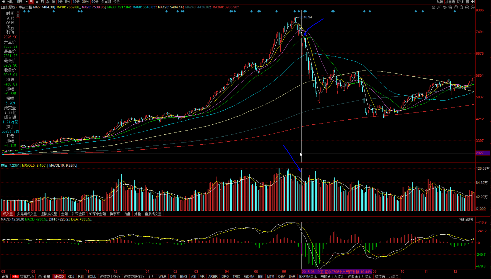

#### 真正的买在底部

普通投资者容易被高点价格锚定，认为跌了20%-30%就是便宜。但事实数据证明，熊市中的资产重估是极度惨烈的。

宁德时代 (300750)	2021年12月3日	走熊一年半后	2年暴涨10倍。跌了20%-30%（7-8折）时大量散户抄底，但走熊1.5年后，市净率（PB）仍高达5倍。概念：高位白马股打折不是底，估值依然昂贵。

中国中免 (601888)	2021年2月18日	一路滑梯	典型的高处坠落，印证“出道即巅峰，余生皆下坡”。

蓝筹股没有无限的成长空间（市值从30亿到3000亿可能，从3000亿到3万亿极难），因此绝对不能追高，必须寻找由恐慌情绪砸出的带基本面背书的“地板价”。

案例标的：京沪高铁 (601816) 基本面数据（后疫情复苏逻辑）即便在疫情最严重的阶段，公司依然保持盈利（毛利率未击穿底线）。

2019年 (正常年份): 营收 326 亿元，毛利率 50.70%

2020年 (疫情暴发): 营收 248 亿元，毛利率 30.22%

2021年 (疫情期间): 营收 288 亿元，毛利率 34.84%

2022年 (疫情严峻): 营收 189 亿元，毛利率 11.88%

极值点套利数据模型：

情绪错杀极值： 4.29元（2022年5月11日，由外界恐慌而非公司基本面败坏砸出）。

买入区间： 月K线下影线部分，即跌回 4.5元 以下。

目标收益率： 20%。

套利测算： 买入价 4.5元 + 0.9元 (20%) = 5.4元（大概率能达到的安全退出点）。

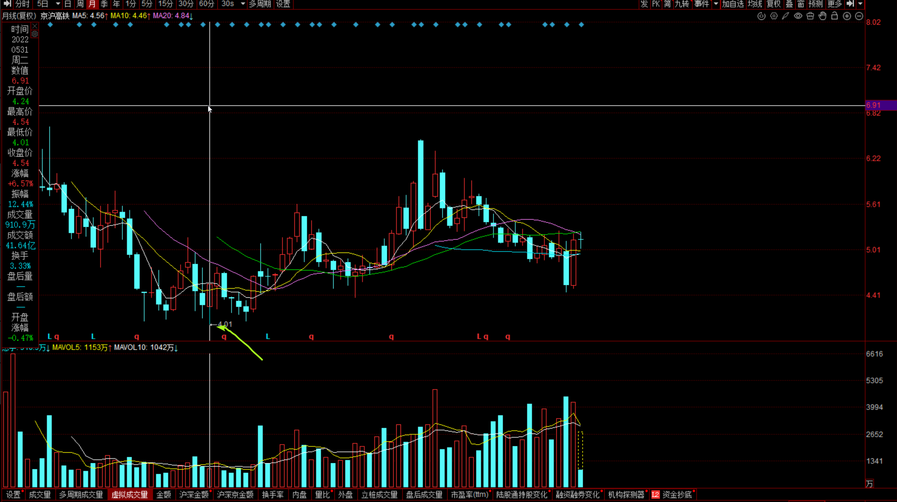

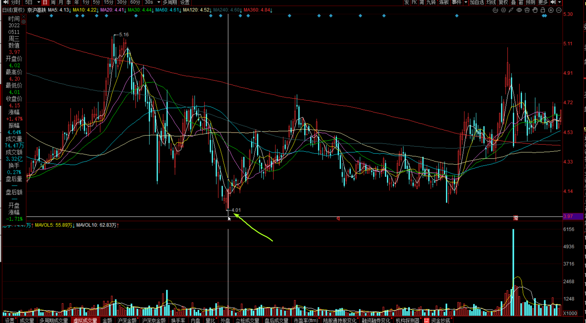

新叶股份(002476)股价在近几年的确没有大涨过。2023年3月20日该股出现了一个跳空涨停,这根涨停称之为“四红K线”。所谓“四红K线”,是指其四个点——高点、低点、开盘、收盘都比前一根K线要高,这往往代表着强势向上转折突破信号。反过来,还有一种叫“四绿K线”

缺口的位置落在5.27元。通常在强势向上转折突破信号出现之后,留下这样的缺口往往具有强劲的支撑作用。因此对于青睐低买的投资者来说,显然不会在涨停板上去追,而是等股价回调再出手。也就是说当股价重新回踩到这个缺口附近,反而是一个很好的上车点。

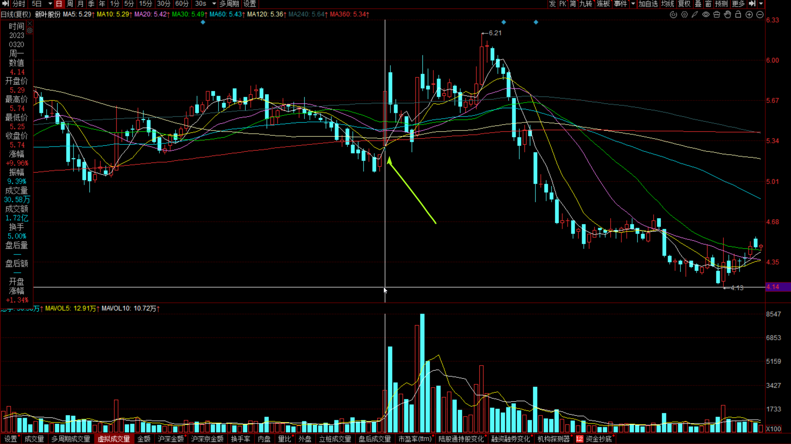

2023年3月24日银星能源（000862），最低价6.43元左右时,就是一个很好的低吸买点。

另一个规律,它的每一波波段操作的上车点都伴随着地量买进。比如2022年12月27日呈地量,换手率仅 0.71%,次日股价涨停;2023年1月13日呈地量,换手率低于2%,次日大涨4.05%;2023年3月23日呈地量,换手率 1.79%,依旧低于2%,次日股价又见涨停。这说明银星能源的主力很喜欢在这只股票没有人玩的时候反向拉一波。

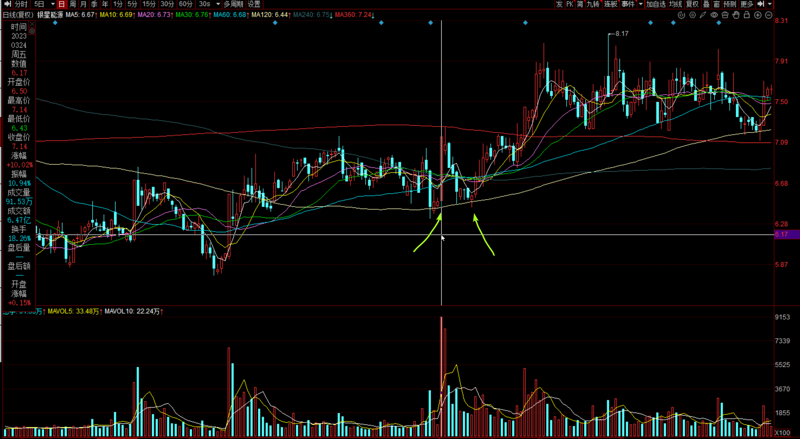

通常想要把低位个股的股性做活,需要一个漫长的过程。三江购物(601116)021年12月底是其启动的第一波行情,一直到2023年4月初,将近一年半的时间总共走出了四波行情。**每一波行情越到最后越凶悍,这是一个循序渐进的过程。**

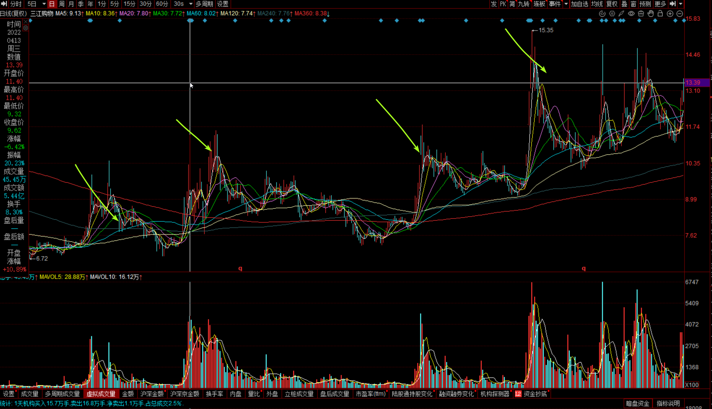

#### 抗住波动

生理上无法接受大波动,但是在战法上一定要接受大波动,这个战法就是“分散投资”,在个股上,我要忍受无限波动,而在总账户上,我要控制波动。只拿5%的资金放在一个个股上。全当送给市场,总账户也就损失了5%而已，为了挣这个25%,我不止损,我愿意输光。实践证明抱着  这种心态来炒股,根本不会输光,相反成功率还很高。

大东南(002263),该股被选出来的时间是2022年11月,随后一路没涨过,还往下沉了沉。但是即便如此,这只股票截止到2023年上半年也没输掉30%。2022年11月21日这一天出现了资金博弈这个指标金叉的信号点。在此基础之上,其复选指标是代表散户的这根绿线数值很小,具备优势;且这一天的换手率达到7.89%,也具有优势——换手率不能太小,通常设在4%以上是一个很好的过滤点。

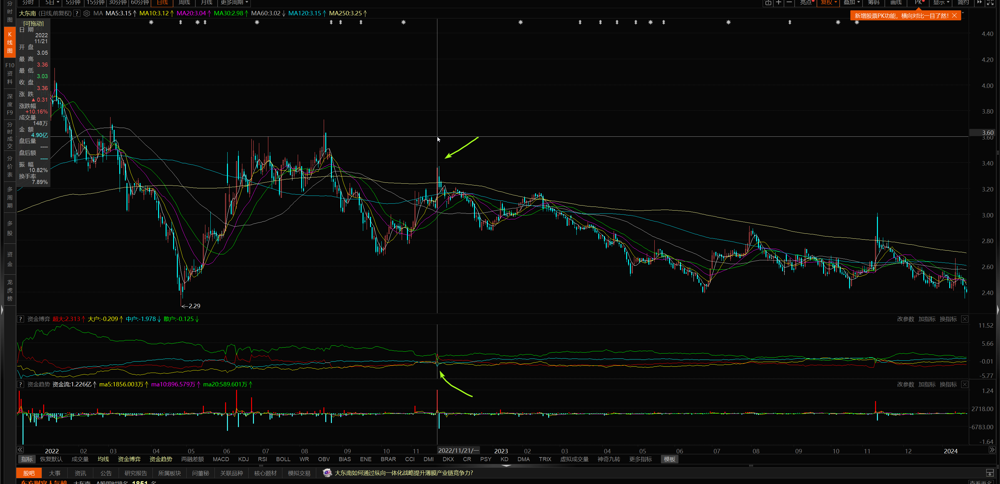

常用的选股方式之一,也就是说如果我选择了相同图形的10只股票,然后我又从中**选取资金博弈指标中“超大”数值最大的3只股票,接着我在“超大”最大的3只股票当中选择“散户”数值最低的股票,或者在这个“超大”数值最大的3只股票当中选择换手率最低的那一只,但与此同时我又会排除换手率在4%以下的股票,最后再看一个“大户”数值,如果是正值或者负值较小,超大线金叉散户线**,那么基本上就能用这些指标做一个十分之一的筛选。

2023年上半年来看,它是失败的,但我依旧将其纳入自选,因为我知道这只股票还有发展空间。就好像睿能科技(603933)也是我按照上述这些条件选出来的,尽管在选出之后的很长一段时间它都没有表现,但在2023年5月突然就爆发了,连续拉出5个涨停板!

#### 抢反弹

抢反弹不等同于低买,低买等的是一个价值回归,需要时间,需要耐心;**而抢反弹挣的是一个情绪差,当情绪恢复正常,便要果断止盈。不要下跌途中抢反弹** 

下跌的过程中,缩量代表着没有人前来抢筹码。如果股价真的足够便宜,必然会有场外的人出手豪买,届时自然会看到有量能放出来。任何的加仓、做T、抢反弹、抄底等等这些动作,都需要等放量信号

上证指数在2022年8月2日这一天便构成了这样的条件,伴随跌幅高达2.26%。单根下跌放量大阴线不是最好的抢反弹的点，真正抢反弹的点是在次日，结合资金趋势指标,在资金流出放缓的情况下,可做反弹。这样的点才可能是半个月之内最好的情绪逆势点。**第一日资金流出量要大，只要在均线1倍处左右，而次日资金流出的缩量必须要缩到一半以上，少量缩量不能进场。**

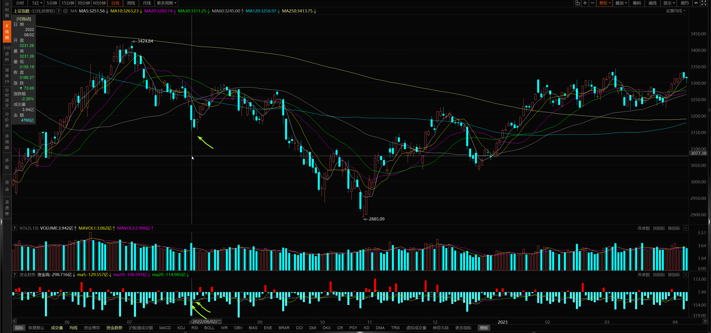

同样的图形还出现在上证指数2022年8月31日和9月1日这两天,前一日成交放量,后一日成交缩量,伴随前一日资金流出而后一日资金流出减缓。因此把9月1日这一天看成是抢反弹的点,随后同样迎来了一波上涨行情。

量能条件的满足说明当天存在矛盾,有足够多的人愿意跑,也有足够多的人想上车。有矛盾就能产生力量的转变,从而形成短期趋势的逆转。如果市场不存在矛盾,类似上证指数 2023年3月10日这根阴K线,其成交量三个数值分别为2.811亿、3.072亿、2.875亿,显然当天的成交量既低于一周也低于一月,这反映出主力并没有顶着散户买。换句话说,空头宣泄的力量没有被强大的多头承接,自然这一天就不是抢反弹的点。

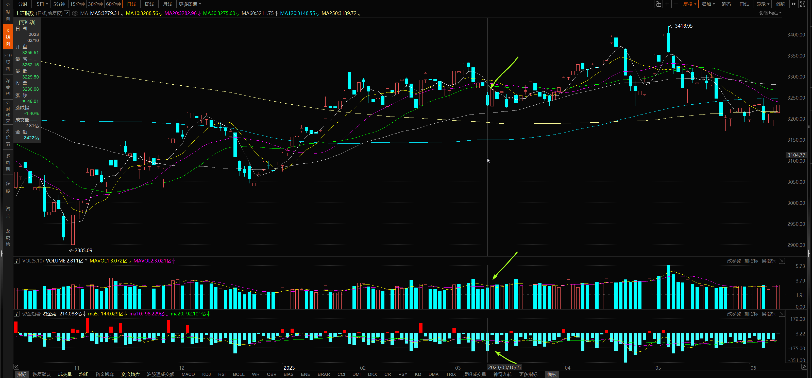

这种图形会经常看到——有一个大的放量,次日放量减缓;有一个大的流出,次日流出减缓。当然还有一种变形,就是次日成交量放得比前一日还要大,但只要次日资金流出是减缓的,也可以被看成是一个可操作的抢反弹的点。

#### 大底的量价

多数情况下,放量始终是好事。在所有技术分析指标当中,除了量和价以外其他全都是假的。不管 KDJ也好,还是MACD或者RSI等等,这些指标全都是人为定量和定性,仅仅反映了对量或者价的看法,并不代表真实的量和价。

底要有绝望，把筹码抛撒开来，当看到底量超顶量,便可预判底部的形成。头肩底用的人多了可能会失真，最好做到肩的地方就逢高卖一笔。

**任何一次大的反转都是底量比整个下跌量都多,有的时候甚至底量比历史都多**，只有在一个很小的区间当中散户都愿意割了,才能形成底。

如果即时天量又是天金额，历史上“天金额”的情况仅仅出现过两次,随后都创出了大行情,这两次大行情留下的烙印就是6124点和5178

上证指数月线图上看2018年11月 交量达到40.5 亿元,在此之前的下跌段当中,没有一根量柱比40.5亿元还要大。月线上的量能更不会骗人.

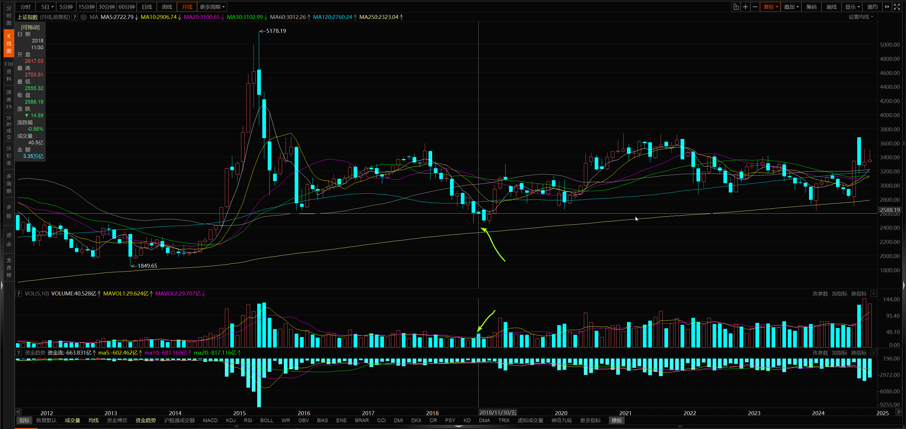

#### 牛市

[股市新增投资者人数指标](https://www.sse.com.cn/aboutus/publication/monthly/investor/)。该指标会在每月上旬5日-10日公布。当某个月份看到这个指标的数值达到200万,下个月要做的动作就只有一个,即“买买买” 涨上去是买,跌下去也是买。

比如2022年4月大盘见底,随后走出一波为期两个月的小牛市行情。而在此前一个月,即2022年3月的新增投资者数量达到230万人。之所以3月开户数井喷之后,4月走势还能再往下砸,其实是有原因的。彼时美元指数飙涨,打压了包括A股在内的很多资产价格,于是才有了上证指数2863这个低点。然而这样的低点在技术上其实是非常有必要的,如果不砸出个更深的位置。则反弹拉不出幅度,硬拉就会让上面的解套盘全部获得解放,这在博弈上是不合适的。好的博弈是既能挣钱同时又不会让原先套住的人解套,那么有这样一个从低到高的区间就可以操作得非常自如。

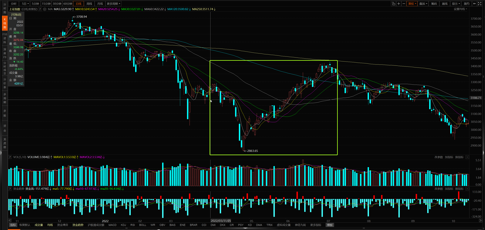

2022年3月份股市大跌而新增开户数却是年内最高,说明股民迫不及待进场抄底的习惯一直未变,要是等到下个月再行动,反而能买到低点。真正赚钱的时候从来都不是牛市上半场,下半场才是高潮迭起。当下半场没购入股票的人都开始往里搬迁推至满仓,而你竟然不拿筹码,那么损失才可能是巨大的。至于刚起步阶段,即使真有所踏空也不用太当回事儿。

一忌抛太早,二忌抛太勤。牛市开头的三个月或者半年时间里面,都会有很多股票没有被流动性覆盖,没有快速涨起来。这个“高”定位假设已经挣了4倍以上,那么就可以选择卖出,因为4倍再翻4倍的概率是很小的,但是3倍再翻3倍的概率还是有的。

应对牛市最简单的策略归纳起来就四个字——买入持有。对于普通投资者来说,过于折腾还不如不折腾。熊市当中多数的买点都不是买点,**传统买点到最后都会变成卖点**,变成“遇见金叉离死不远”的事实。

既然熊市金叉多骗人,反过来牛市死叉也骗人。在上升途中每一次震荡的终点,即技术指标走空头,或者某个大家关注的技术位置跌破之后,往往就是一个反手点。所以牛市其实并不存在什么“线上阴线买”的问题,遇到线上阴线的最优解就是“扛”,打到线下阳线去抛,打到跌破反抽结构去抛,打到反抽确认去抛。

找具有行业代表性的、股价位置低的、估值也在低位的股票。这些股票在过去有个现象,它们的发力通常只在牛市下半场才会显现,而在上半场几乎看不到它们赢的一面。它们只是迟到,但从未缺席。

#### 跟随趋势

除了之前所介绍的“线上持股,线下持币”这一招外,有一个指标也能帮助我们很好地跟踪股价趋势,那就是DMI。DMI 指标默认参数是(14,6),代表的是深回档

DMI 指标默认参数是(14,6),代表的是深回档。如果把参数数值切一半,改成(7,3),则代表的是浅回档。DMI 最主要的两根线是PDI和MDI。PDI是-DI,代表下跌;MDI是+DI,代表上涨。当+DI 一直在-DI之上,就构成了上涨趋势,该指标表现为蓝线在粉线之上。反之,下跌趋势则是粉线在蓝线之上。

如果严格执行DMI 指标粉线在蓝线之上不买的铁律,就能躲过2022年5月17日之前的整个回调过程。

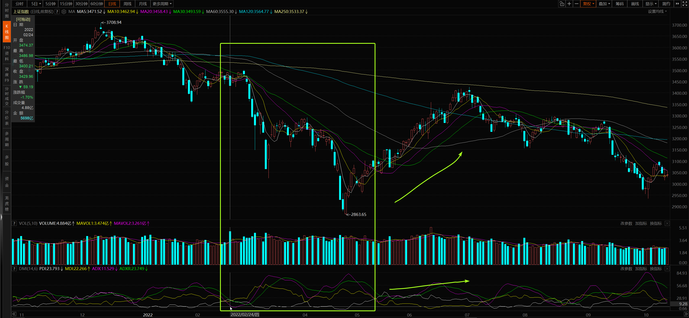

下跌趋势中，多头能做到的最强力量是形成一个金叉之后就再也没有力气，所以下跌趋势谨慎看多。

DMI 指标还有灰线和褐线,代表着 ADX(平均趋向指数)和ADXR (平均趋向指数评估)。ADX向上,代表有趋势;ADX向下,代表无趋势。这个趋势由PDI,MDI 两线决定,MDI在上是下跌趋势,MDI在下是上涨趋势。

中证1000 4月28日这一天不宜做多，只是不做空而已。假如持有空单的投资者自4月18日开始参与了这一波跌势,那么到了4月28日这一天就应该了结空单。ADX 这根线走缓说明趋势停滞了

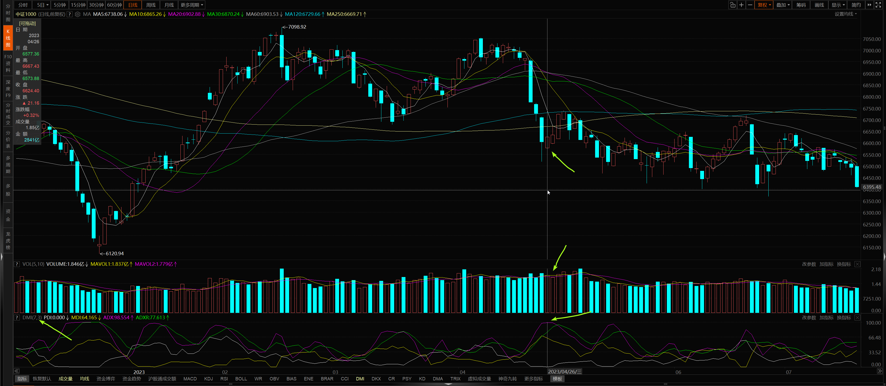

通常有上下两个极限值,当它打到趋势的极限值的时候,我们通常可以去做趋势转折的预判。比如中证1000指数 2022年12月23日这一天,灰线和褐线同时打到极值100,那么这个时候就算投资者看不懂底分型这个K线形态,但通过指标也能大致判断这里可能会出现一个比较好的转折点

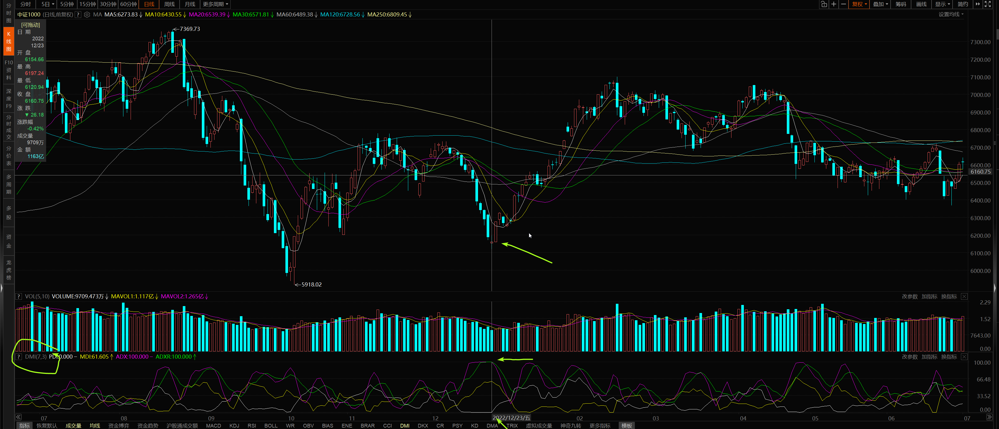

第三种用法,下跌趋势要达到动量以上, ADX 至少要大于 MDI 数值才可抄底。如果粉线在上,而灰线没有跟上的时候,不要轻易去赌趋势结束,底肯定还没有到。

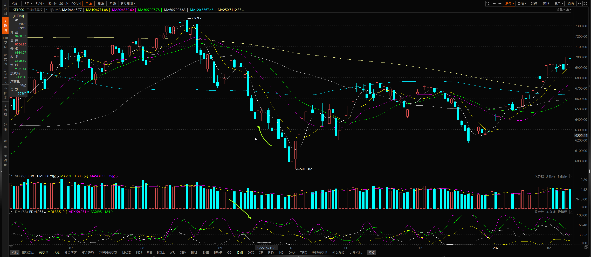

有的时候灰线和褐线的交叉也可以认为是趋势的终结,但准与不准还是要比对套用14天周期还是7天周期之后才能大致有所了解。

精通一招，规避掉这一招不能用的时候。

#### 布林线

由三根线组成——上轨、中轨和下轨。中轨就是均线,对应参数20就是指20天均线,上轨和下轨是均方差,参数2就是指2倍的股价标准差。

蓝色光标(300058) 2023年2月3日的这根周K线,光从肉眼观察就能发现布林线走的是一个由收敛到打开的过程,而我喜欢的介入点正是落在这种位置。

(上轨下轨)×100%,对应到2月3日这根周K线的布林线数值,即6.24-3.97×100%=157%,这是一个很经典的打开图形，因为通常A股股价能压到的一个重要极限值是130%。

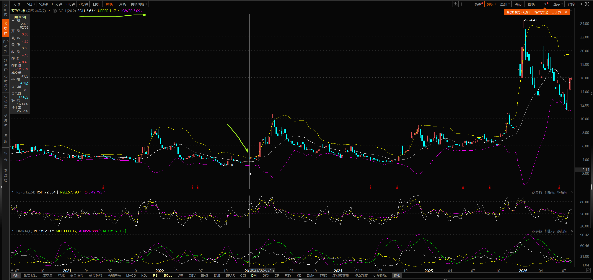

蓝色光标最开始的买点信号出现在2022年11月4日的这根周K线上,从技术形态来看彼时走出了一个**强底分**,然而布林线仍呈一个开口状态。

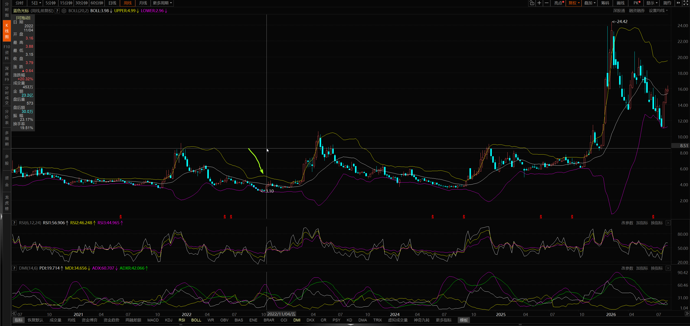 

千万不要在布林线开口状态当中去做股票。类似上图这种地方,建仓往往始于此,且建仓必有洗盘,而我们永远不会知道主力洗盘会洗多久,只有等它收敛之后再次张开 牙,才是性价比极高的点。

布林线的开口,代表的是趋势状态;而布林线的收口,代表的是平衡状态。所谓“强趋势”行情就是上轨上行和下轨下行——强势上涨的时候,股价始终挂着布林线的上轨;强势下跌的时候,股价始终挂着布林线的下轨。一旦挂不住,则趋势可能发生转折。所以对于布林线来说,口子打开得越大,越是高风险

对于一只强势上涨的个股,它的极限就是布林线的上轨,且很少能看到有落在周线3倍标准差之外的地方，西安饮食 周K线在2022年11月18日

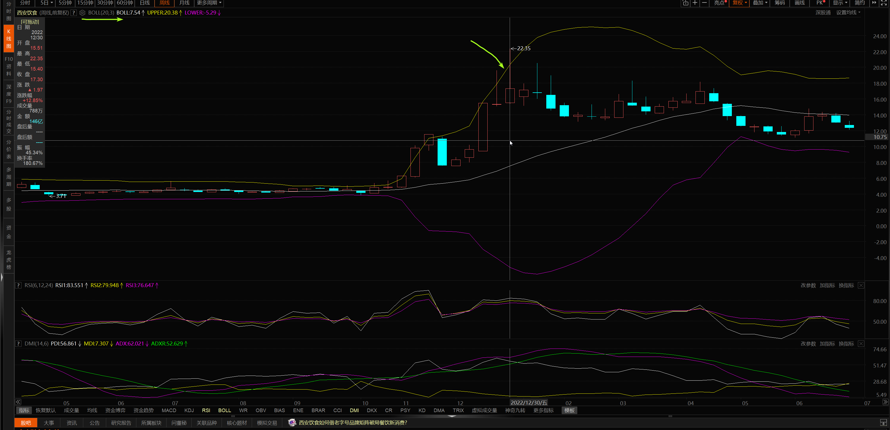 

蓝色光标 2021年12月33日的这根周K线也走了一个打开拉回的图形,前面两根K线的上影线均上穿到上轨之外,于是短期就产生了向下的均值回归,但回归的幅度并没有完全走完,随后再一波拉起,接着走势慢慢趋坏,直到这一波的涨幅全都回吐完成,便很规矩地从上次的启动点开始再来一遍。

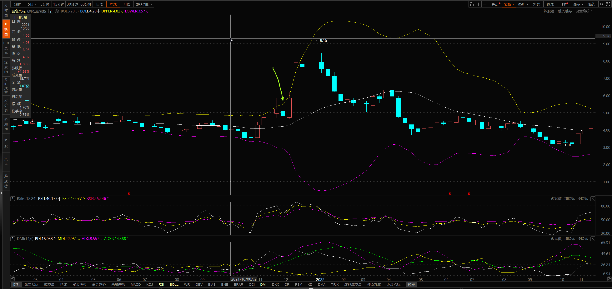 

均值回归存在一个节奏,往往越是平静段的行情,越可以去关注。比如天迈科技(300807)周K线2021年7月、12月以及2022年8月的这三次走势。

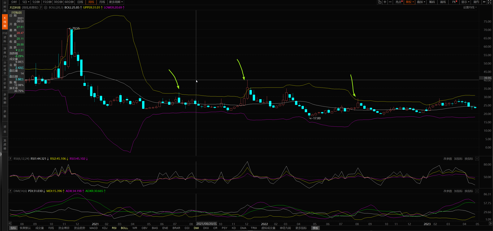

筹码回接的小技巧,即周线布林中轨参数“20”对应的数值加2%等于回接的价格。

当天迈科技在6月21日这周出现回落后,下一周我们大概率可以按照6月30日这根周K线的中轨数值即25.89元加上2%,相当于加5毛钱,以26.40元的价格把筹码重新买回来，筹码回接的前提永远是这只股票还在做多周期当中。一旦做多周期发生转变,抛了也就抛了。
x
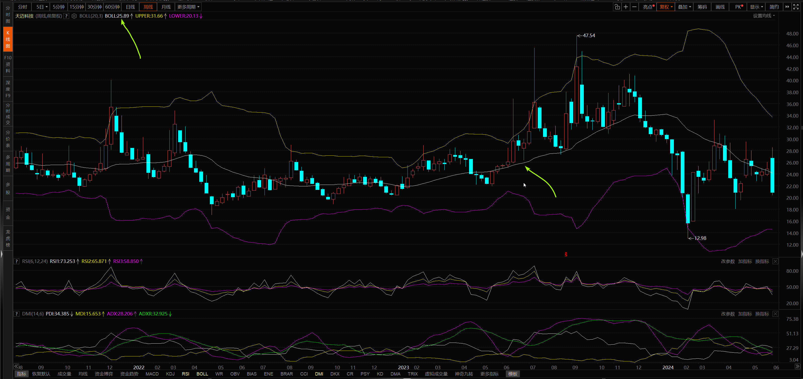

**超跌反弹的属性,从低位起来的第一波通常到不了周线3倍标准差,2倍标准差有时也很难到达。**

个股高抛点看周线,指数高抛点则看日线。2021年2月18日我预判上证指数跌400点的封神之举,就是用到了日线级别的3倍标准差。

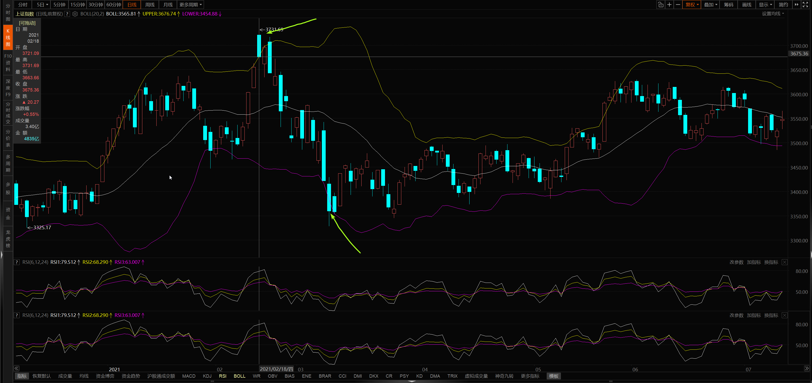

上证指数2021年2月的这一波往下打到中轨后没有刹住,直逼布林线下轨。但有时股价在回拉的过程中,布林线中轨会扮演一个“高压电线”的作用。如同中证全指缩小一个级别,在60分钟图上看2023年1月12日和1月31日左右的这种走势,当股价触碰到了这根高压线,就会“蹭”一下往上跳起。

倘若股价打到布林线中轨继续往下,这时就要小心了,这种大概率是破坏性行情,上升通道很难再维系。只不过一般来说,行情很少会出现A杀,在“高压有电”失效之后,在这个地方都会由竖转横,如中证全指2023年2月这一段。而且,在回拉的过程中,布林线下轨越是上行,越会形成第一波的支撑,特别是在这个支撑此前从未被考验过的情况下。

当股价第一次甚至第二次打到布林线下轨的时候,往往都可以接,尤其第一次往回接的成功率很高。但在接的同时你心里得明白,这不是一个好现象。

